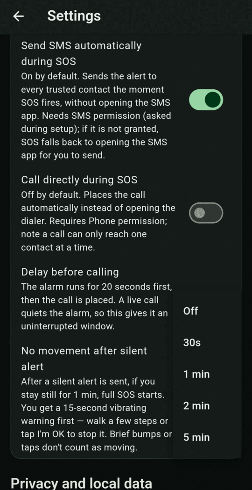

# No-movement check

After a silent alert has been **sent**, BY Protect watches for the next **10 minutes**. If you stop moving, for example because you've been knocked down or can't move, the alert is raised to **Level 3 · Full SOS**.

## How it works

1. For 10 minutes after the silent alert is sent, the app watches your movement.
2. If you stay still for the time set in **No movement after silent alert** (default **1 min**), a full SOS starts.
3. **15 seconds before** that, you get a warning:
    - a repeating **vibration**, if **Settings → SOS actions → Vibration** is on (the default),
    - a red **No movement — SOS in 15s** banner on the Dashboard that counts down to 0, with an **I'm OK** button,
    - the notification text **No movement detected — tap I'm OK to stop SOS**, with an **I'm OK** button.

!!! warning "Keep Vibration on"
    With **Vibration** turned off, the warning is only on screen and in the notification. You won't feel anything, so you could miss it and a full SOS would start.

## To stop it

- **Walk a few steps.** About two seconds of real movement within four seconds counts. A single bump, tap or jostle doesn't, and neither does the phone's own warning vibration.
- **Or tap I'm OK**, on the Dashboard banner or in the notification.

Moving restarts the stillness timer. Tapping **I'm OK** ends the check completely.

## Change or turn it off

**Settings → Direct emergency actions → No movement after silent alert**. Options: **Off**, **30s**, **1 min** (default), **2 min**, **5 min**.

{ .screen }

With **Off**, a silent alert never raises itself to a full SOS.
