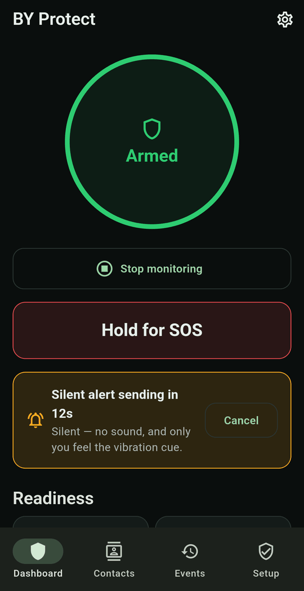

# Silent alert countdown

When the app reaches **Level 2 · Silent Alert**, it gives you a chance to stop it before anything is sent.

## What you'll notice

- **One short vibration** (if **Vibration** is on, the default), which only you feel. There is no sound, so someone nearby isn't alerted.
- An amber **Silent alert sending in 15s** banner on the Dashboard that counts down to 0, with a **Cancel** button.
- The notification text changes to **Silent alert sending — tap Cancel Alert to stop it**, with a live countdown timer.

<figure markdown>
{ .screen }
<figcaption>Silent alert countdown</figcaption>
</figure>

!!! warning "Keep Vibration on"
    The vibration comes from **Settings → SOS actions → Vibration**, which is on by default. If you turn it off, a silent alert counts down with **no vibration at all**. With the screen off, you'd have no way of knowing it was happening.

## To cancel

Do either of these within the 15 seconds:

- tap **Cancel** on the Dashboard banner, or
- tap **Cancel Alert** in the notification. This works from the lock screen or while you're in another app.

The event is saved as *Cancelled before it sent*, and nothing reaches your contacts.

Stopping monitoring also cancels a pending silent alert.

## If you don't cancel

When the countdown reaches zero:

1. An SMS with your location is sent to **every enabled contact**, silently. No SMS app or dialer opens on screen.
2. The last few video clips are protected so they aren't overwritten.
3. The [no-movement check](no-movement.md) starts.

!!! warning "Silent alerts need automatic SMS"
    A silent alert sends only when **Send SMS automatically during SOS** is on and SMS permission is granted. It never opens the SMS app, because that would show on screen. If either is missing, the event is still saved, but no message goes out.
