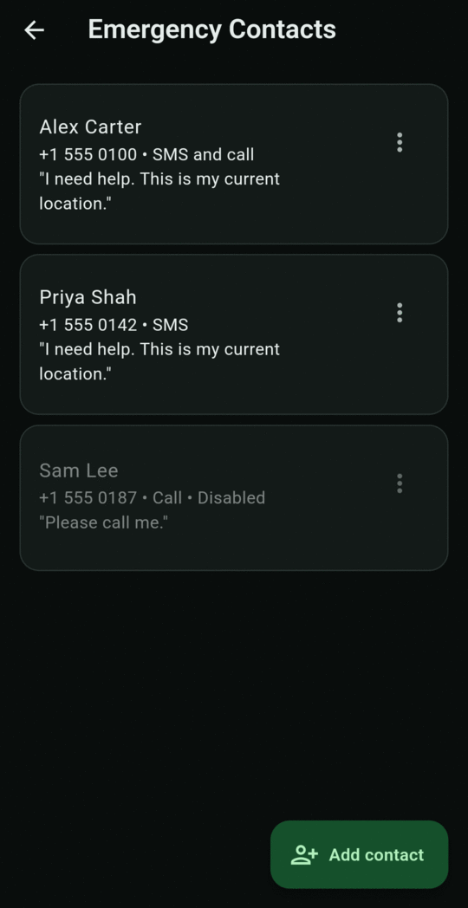
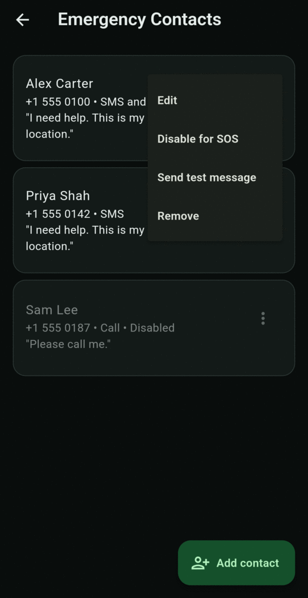
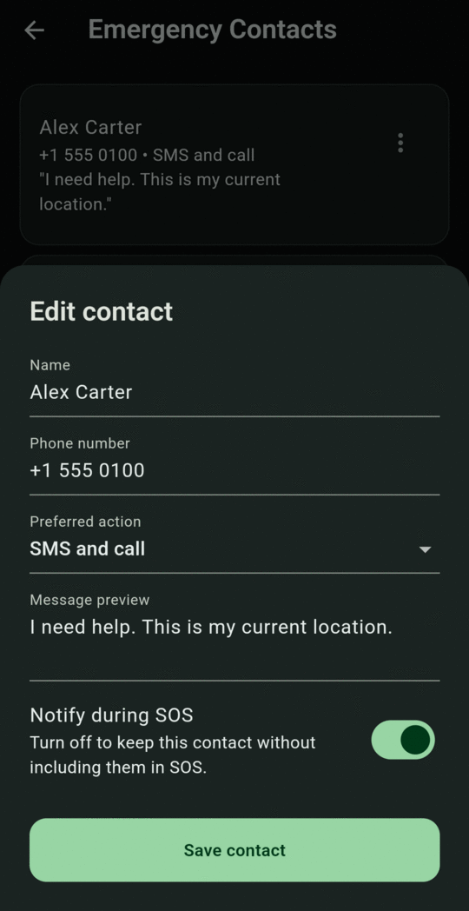
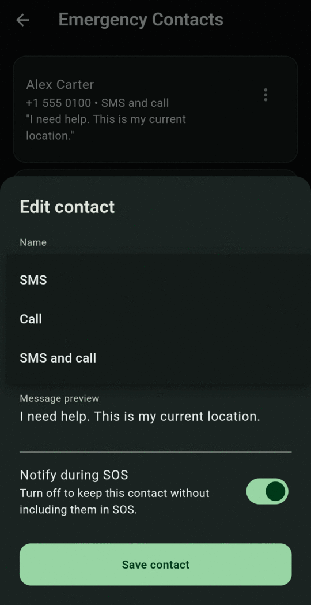
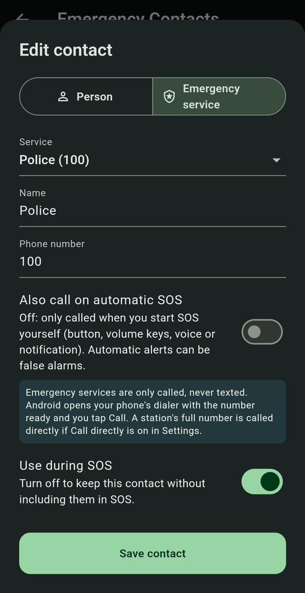
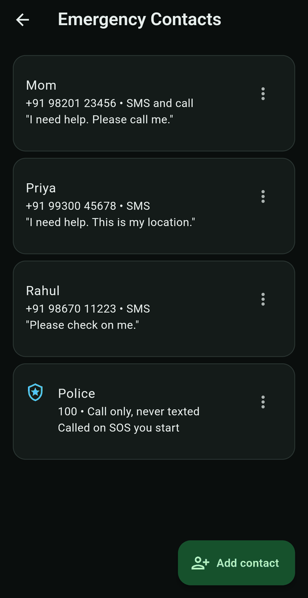

# Emergency contacts

Open **Contacts** from the bottom bar. A contact is either a **person** you trust or an **emergency service** such as the police. Each card shows the name, number and what SOS does for them. Disabled contacts are greyed out and marked **Disabled**.

<figure markdown>
{ .screen }
<figcaption>Contacts</figcaption>
</figure>
<figure markdown>
{ .screen }
<figcaption>The ⋮ menu</figcaption>
</figure>

## Add a person

Tap **Add contact**, keep **Person** selected, fill in the form and tap **Save contact**. **Name** and **Phone number** are required.

| Field | What it does |
|---|---|
| **Name** | How the contact appears in the app. |
| **Phone number** | The number to text or call. Include the country code if they're abroad. |
| **Preferred action** | **SMS**, **Call**, or **SMS and call** (default). |
| **Message preview** | Your own words, placed at the top of the automatic alert text. |
| **Notify during SOS** | Turn off to keep the contact saved but leave them out of alerts. |

<figure markdown>
{ .screen }
<figcaption>Edit contact</figcaption>
</figure>
<figure markdown>
{ .screen }
<figcaption>Preferred action</figcaption>
</figure>

## Add the police or another emergency service

Tap **Add contact** and choose **Emergency service** at the top. Then pick the service:

| Service | Number |
|---|---|
| **Police** | 100 |
| **National emergency** | 112 |
| **Women in distress** | 1091 |
| **Women helpline** | 181 |
| **Ambulance** | 108 |
| **Local police station** | The station's own phone number, which you type in |

The name and number fill in for you. Tap **Save contact**.

<figure markdown>
{ .screen }
<figcaption>Emergency service</figcaption>
</figure>
<figure markdown>
{ .screen }
<figcaption>Police in the list</figcaption>
</figure>

How emergency services are used:

- **They are only called, never texted.** No SOS message or silent alert is ever sent to them, and there is no test message.
- **They get the SOS call.** SOS makes one call. If an emergency service is enabled, that's the call, instead of your first person. If you add more than one, the highest in the list is used.
- **You tap Call for 100, 112 and the other short numbers.** Android doesn't let apps call emergency numbers by themselves, so your phone's dialer opens with the number ready. A local police station's full number is called directly if [Call directly during SOS](settings.md#direct-emergency-actions) is on.
- **Only when you start SOS yourself, unless you choose otherwise.** By default they're called when you start SOS with the button, the notification, the volume buttons or "help me". Turn on **Also call on automatic SOS** to call them for automatic alerts too. Automatic alerts can be false alarms, so think before you turn it on.
- **A call button appears during SOS.** The Dashboard shows **Call Police (100)** and the SOS notification shows **Call Police**, in case the dialer didn't open by itself.

!!! tip "Let SOS open the dialer from your bag"
    When the app isn't on screen, Android only lets it open the dialer if you allow **Display over other apps**. Turn it on in **Setup**. See [Grant permissions](getting-started/permissions.md#optional-permissions).

## The ⋮ menu

Edit
:   Change any field.

Disable for SOS / Enable for SOS
:   Temporarily leave a contact out of alerts without deleting them.

Send test message
:   Opens your SMS app with this contact's message filled in. Nothing is sent until you press send there. Not shown for emergency services.

Remove
:   Deletes the contact after you confirm.

## Tips

- Add **at least two** people, in case one can't answer.
- Only one call is placed per SOS. It goes to an enabled emergency service if you have one (see above), otherwise to the **highest person in the list** set to **Call** or **SMS and call**. New contacts are added to the bottom, so add the person you most want called first, or set the contacts above them to **SMS**.
- Tell your contacts you've added them, and what a BY Protect alert looks like. Show them [What your contacts receive](alerts/messages.md).
