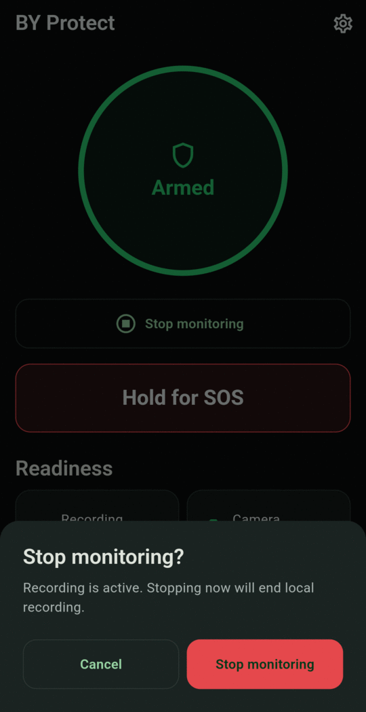

# Arming and stopping

## Arm

Tap **Arm monitoring** on the Dashboard. The ring goes from **Starting** to **Armed**.

Arming also sets the phone's **alarm volume to maximum**, so an SOS alarm is always loud. It stays there after you stop. Lower it in Android's sound settings if other alarms are now too loud.

Settings marked *takes effect next time you arm monitoring*, such as **Camera** and **Record audio with video**, apply the next time you arm.

!!! warning "If arming fails"
    If the ring shows **Error**, read the message inside it:

    - *Camera or microphone permission missing*: grant it on the **Setup** screen.
    - *Not enough free storage to record*: free up space, or lower [Minimum free storage](../settings.md#recording-and-retention).

## Stop

Tap **Stop monitoring**. If video is recording, the app asks you to confirm:

{ .screen }

Tap **Stop monitoring** to confirm, or **Cancel** to keep monitoring.

You can also stop from the notification by tapping **Stop**.

Stopping monitoring also:

- cancels any alert that is still counting down,
- stops the SOS alarm, vibration and torch, and cancels an SOS call that hasn't been placed yet,
- turns off the camera, microphone and motion monitoring.

The last few minutes of unprotected video (the rolling buffer) stay on the phone until the next time you arm, when they're cleared. To remove them straight away, use [Delete all local data](../privacy.md#delete-all-local-data).

!!! note "Restarts"
    If the phone restarts, monitoring is off when it comes back on. Arm it again.

## The monitoring notification

While armed, Android shows an ongoing notification titled **Personal safety monitoring**. Its text and buttons change with the situation:

| Situation | Text | Buttons |
|---|---|---|
| Normal | Monitoring active | Stop · Cancel Alert · SOS |
| Silent alert counting down | Silent alert sending — tap Cancel Alert to stop it | Stop · Cancel Alert · SOS |
| No-movement warning | No movement detected — tap I'm OK to stop SOS | Stop · I'm OK · SOS |
| SOS active | SOS active | SOS |

During a countdown, the notification shows a live timer.

{ .screen .screen-wide }
