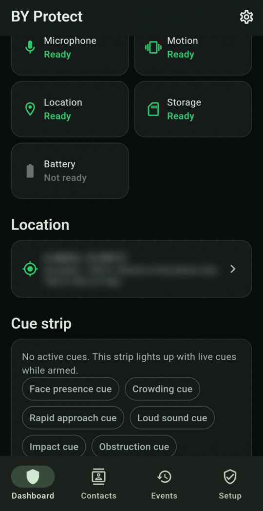
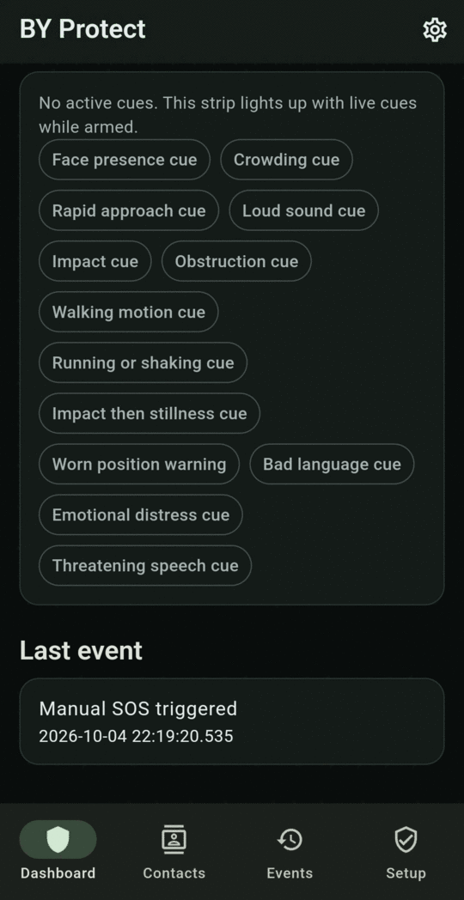

# The Dashboard

The Dashboard is the app's home screen. From top to bottom:

<figure markdown>
{ .screen }
<figcaption>Status ring, controls and readiness</figcaption>
</figure>
<figure markdown>
{ .screen }
<figcaption>Readiness, location and cue strip (location blurred)</figcaption>
</figure>
<figure markdown>
{ .screen }
<figcaption>Cue strip and last event</figcaption>
</figure>

## Status ring

| Ring | Meaning |
|---|---|
| **Set up required** (amber) | A required permission is missing. Tap the button below it to fix. |
| **Unarmed** (grey) | Monitoring is off. |
| **Starting** (blue) | Monitoring is starting up. |
| **Armed** (green) | Monitoring is running. |
| **Alert** (red) | An SOS is active. |
| **Error** (red) | Monitoring couldn't start. The reason appears inside the ring, for example *Not enough free storage to record*. |

## Controls

- **Arm monitoring** / **Stop monitoring**: see [Arming and stopping](arming.md).
- **Hold for SOS** or **SOS countdown**: appears only while armed. Which one you see depends on the [SOS behavior](../settings.md#sos-behavior) setting. See [Ways to trigger SOS](../sos/triggers.md).
- **Countdown banners**: appear when an alert can still be stopped. See [Silent alert countdown](../alerts/silent-alert.md) and [No-movement check](../alerts/no-movement.md).

## Readiness

Each tile shows **Ready** in green or **Not ready** in grey:

| Tile | Ready when |
|---|---|
| Recording | The rolling video buffer is recording. |
| Camera | The camera is running. |
| Microphone | Sound monitoring is running. |
| Motion | Motion sensors are running. |
| Location | Location is available. |
| Storage | There is enough free space to record. |
| Battery | The battery is above 15%. |

While unarmed, most tiles show **Not ready**. This is normal.

## Location

Shows the latest location the phone has recorded and how accurate it is. Tap the card to open it in your maps app. This is a snapshot, not live tracking. Before the first location is recorded, it says *No location fix yet*.

## Cue strip

Lists every type of cue the app can detect. While armed, a cue lights up for a few seconds when it's detected, so you can see what the app is noticing. For what each cue means, see the [Glossary](../glossary.md#cues).

## Last event

The most recent saved event. Open **Events** to see them all.

Pull down on the Dashboard to refresh it.
