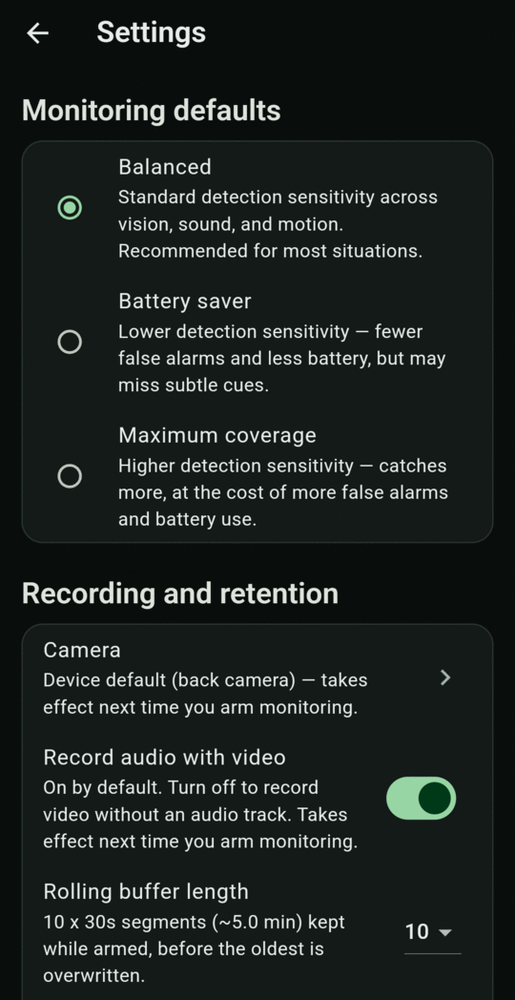

# Monitoring presets

**Settings → Monitoring defaults** sets how sensitive cue detection is. One preset applies to vision, sound and motion together.

{ .screen }

| Preset | Sensitivity | Choose it when |
|---|---|---|
| **Balanced** (default) | Standard | Most situations. |
| **Battery saver** | Lower | You want fewer false alarms and less battery use, and accept that subtle cues may be missed. |
| **Maximum coverage** | Higher | You want to catch more, and accept more false alarms and battery use. |

!!! tip
    If you get frequent silent-alert countdowns in normal situations, such as busy streets or loud music, try **Battery saver**. If you're in a higher-risk situation, use **Maximum coverage**.
