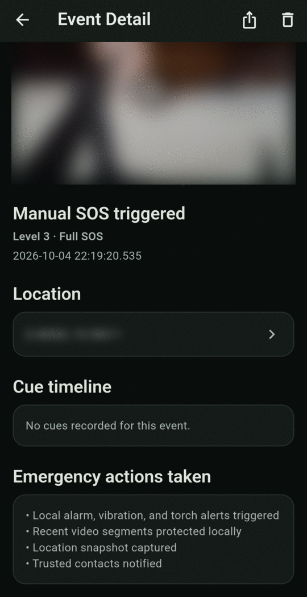
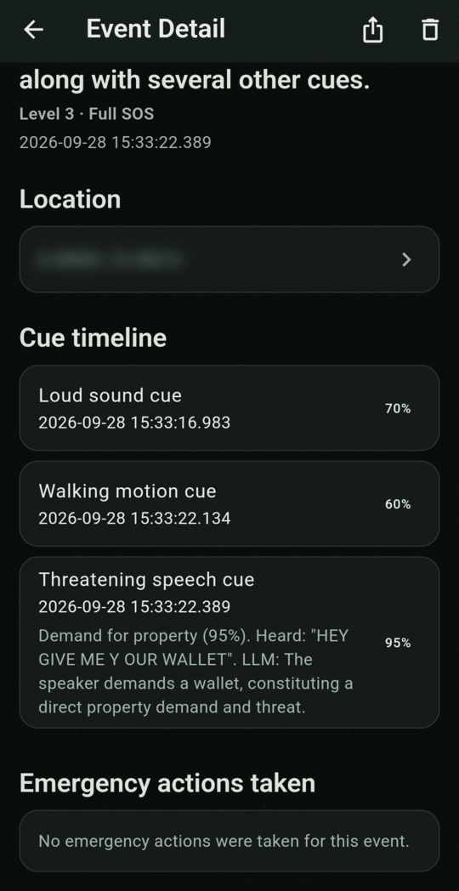

# Event Detail

Tap any event in Event History to see what happened, when, where and why.

<figure markdown>
{ .screen }
<figcaption>A manual SOS (video and location blurred for this guide)</figcaption>
</figure>
<figure markdown>
{ .screen }
<figcaption>An automatic SOS with speech evidence in the cue timeline</figcaption>
</figure>

## Protected video

The protected clips recorded **before** the event. Tap ▶ to play. Clips play one after another. A label such as *Clip 1 of 3 · ~75s before trigger* shows how long before the event each clip started. If there's no video, you'll see *No local media for this event*.

## Summary

The title, the level (with *Cancelled before it sent* or *Still pending* if that applies) and the date and time.

## Location

Where you were. Tap to open it in your maps app. If **Attach location to events** was off, or no location was available, it says *No location captured for this event*.

## Cue timeline

Each cue that contributed, with its time and how confident the app was (as a percentage). For speech cues, the timeline also shows **what was heard** and **why it was flagged**, for example:

> Demand for property (95%). Heard: "HEY GIVE ME Y OUR WALLET". LLM: The speaker demands a wallet, constituting a direct property demand and threat.

The transcript is produced on the phone, so it may contain mistakes.

## Emergency actions taken

What the app actually did, for example:

- Local alarm, vibration, and torch alerts triggered
- Recent video segments protected locally
- Location snapshot captured
- Trusted contacts notified

The **share** and **delete** icons at the top are covered in [Export and delete](export-delete.md).
