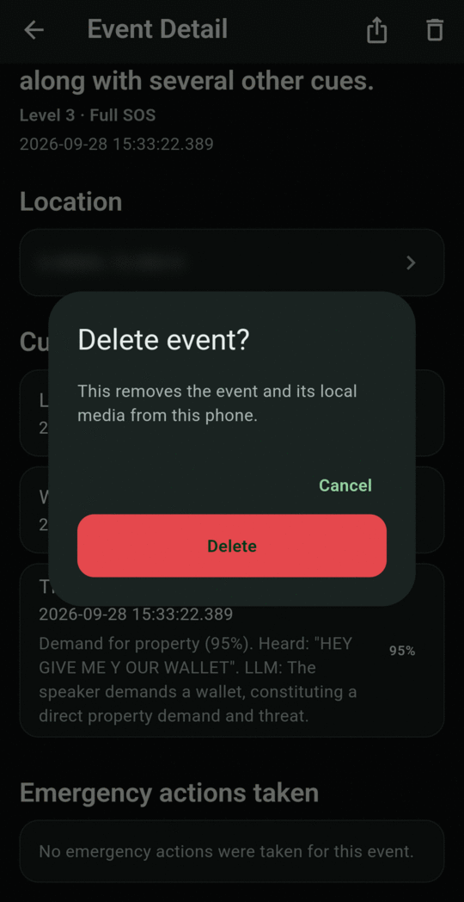

# Export and delete

## Export an event

On **Event Detail**, tap the **share** icon at the top right. Android's share sheet opens with:

- the event's first protected video clip, if there is one, and
- a short text summary: what happened, why, the time and the location.

Nothing is shared until you pick an app or person in the share sheet. Use this to send evidence to the police, a lawyer or someone you trust.

## Delete an event

On **Event Detail**, tap the **bin** icon, then **Delete**. The event and its cues are removed, and so are its protected video clips. Clips that another event also uses are kept until that event is deleted too.

{ .screen }

!!! tip "Free up space"
    Protected clips are never deleted automatically. They stay until you delete their event. If free space runs low, delete events you no longer need, or use **Delete all local data**.

## Delete everything

To erase all events, cues and protected video at once, go to **Settings → Privacy and local data → Privacy and delete all local data → Delete all local data**. You'll be asked to confirm twice. This can't be undone. See [Privacy and your data](../privacy.md#delete-all-local-data).
