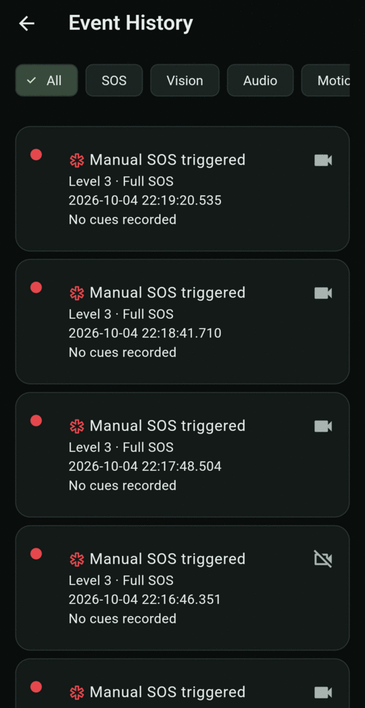
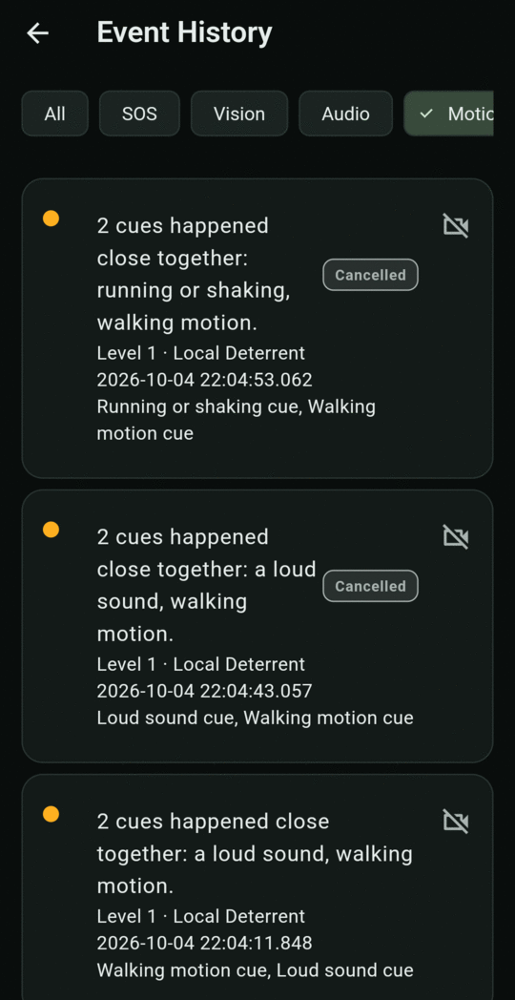

# Event History

Open **Events** from the bottom bar. Every alert and SOS is saved here, newest first, and stays on your phone only.

<figure markdown>
{ .screen }
<figcaption>All events</figcaption>
</figure>
<figure markdown>
{ .screen }
<figcaption>Filtered to Motion, showing cancelled Level 1 alerts</figcaption>
</figure>

## Reading an event row

- **Coloured dot**: the level. Amber is Level 1, orange is Level 2, red is Level 3.
- **Red SOS icon** before the title: you triggered it yourself (manual or voice SOS).
- **Title**: what happened, for example *Manual SOS triggered* or *3 cues happened close together: …*.
- **Level label**, for example *Level 2 · Silent Alert*.
- **Date and time.**
- **Cues** involved, or *No cues recorded*.
- **Camera icon**: protected video is available. A crossed-out camera means there's no video.
- **Badges**: **Cancelled** means you cancelled it before anything was sent. **Pending** means its countdown hadn't finished. An old event that still says **Pending** was interrupted, for example because monitoring stopped unexpectedly, and nothing further will happen with it.

## Filters

Tap a chip at the top to narrow the list:

| Filter | Shows events with |
|---|---|
| **All** | Everything. |
| **SOS** | SOS you triggered yourself. |
| **Vision** | Face presence, crowding or rapid approach cues. |
| **Audio** | Loud sound, or speech cues (bad language, distress, threatening speech). |
| **Motion** | Walking, running or shaking, impact, impact then stillness, or worn position cues. |
| **Obstruction** | A blocked camera, meaning the app may have missed something. |

Pull down to refresh. Tap an event to open [Event Detail](detail.md).
