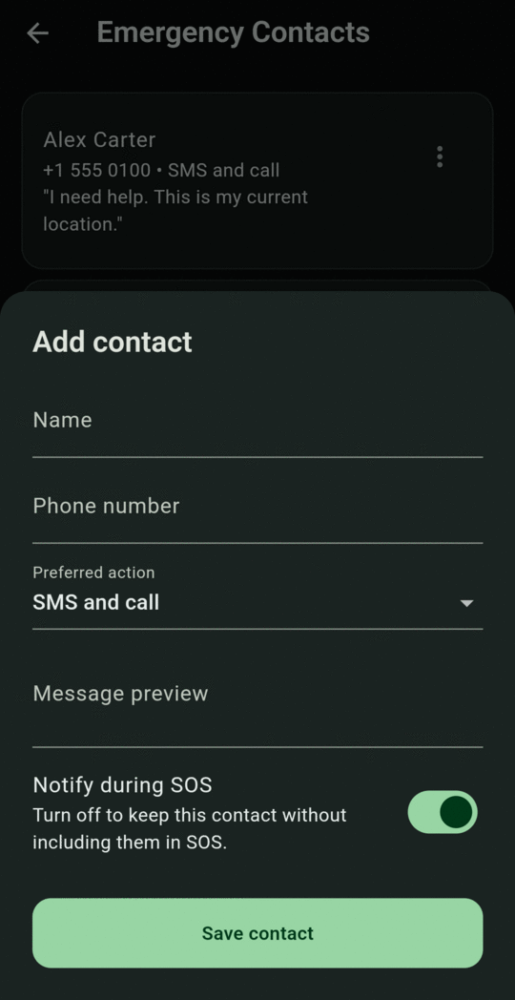

# Add emergency contacts

Trusted contacts are the people BY Protect notifies during an alert. Add at least one before you rely on the app.

1. Tap **Contacts** in the bottom bar.
2. Tap **Add contact**.
3. Enter the **Name** and **Phone number**.
4. Choose a **Preferred action**: **SMS**, **Call**, or **SMS and call**.
5. Optionally, write a **Message preview**. This personal note goes at the top of the alert text.
6. Leave **Notify during SOS** on.
7. Tap **Save contact**.

<figure markdown>
{ .screen }
<figcaption>Add contact</figcaption>
</figure>
<figure markdown>
{ .screen }
<figcaption>Your trusted contacts</figcaption>
</figure>

!!! tip "Test it"
    Use **⋮ → Send test message** on a contact to check the number. This opens your SMS app with the message filled in. Nothing is sent until you press send there.

For editing, disabling and removing contacts, see [Emergency contacts](../contacts.md).
