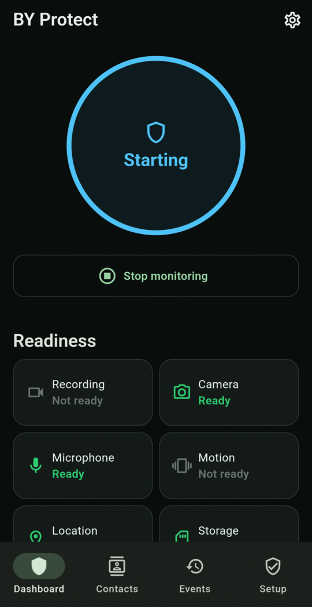
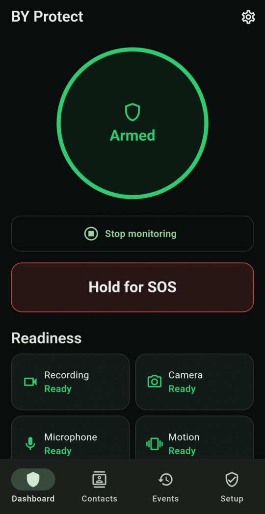

# Arm monitoring for the first time

1. Open the Dashboard.
2. Check the ring says **Unarmed**. If it says **Set up required**, finish [granting permissions](permissions.md) first.
3. Tap **Arm monitoring**.
4. The ring briefly turns blue and shows **Starting** while the camera and sensors start up. It then turns green and shows **Armed**.

<figure markdown>
{ .screen }
<figcaption>Starting</figcaption>
</figure>
<figure markdown>
{ .screen }
<figcaption>Armed</figcaption>
</figure>

While armed:

- A **Personal safety monitoring** notification stays in your notification shade. You can close the app and monitoring keeps running.
- The camera records a rolling buffer of short clips. Older clips are overwritten unless an event protects them.
- The **SOS** button appears on the Dashboard.
- The phone's **alarm volume is set to maximum**, so an SOS alarm is loud. It stays at maximum after you stop, so lower it in Android's sound settings if your alarm clock is too loud. See [Limitations](../limitations.md#your-phones-alarm-volume).

!!! warning "After a restart, arm again"
    Monitoring doesn't turn itself back on after the phone restarts or the battery runs out. Open BY Protect and tap **Arm monitoring**.

## Wearing the phone

For the camera to see what's in front of you, wear the phone facing outward, for example in a chest harness, clip or open pocket. A covered camera is reported as an *Obstruction* cue. If the camera can't see, the app can still detect sound, motion and speech.

!!! note "Battery"
    Monitoring uses the camera continuously, which uses a lot of battery. Start with a full charge, and see [Monitoring presets](../daily-use/presets.md) and [Troubleshooting](../troubleshooting.md#battery-drains-quickly).

Next: [learn the Dashboard](../daily-use/dashboard.md).
