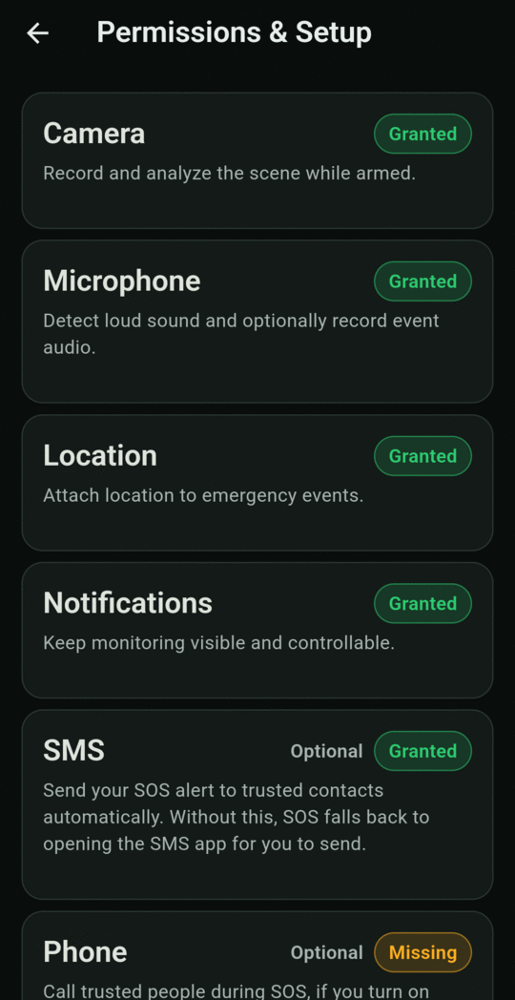
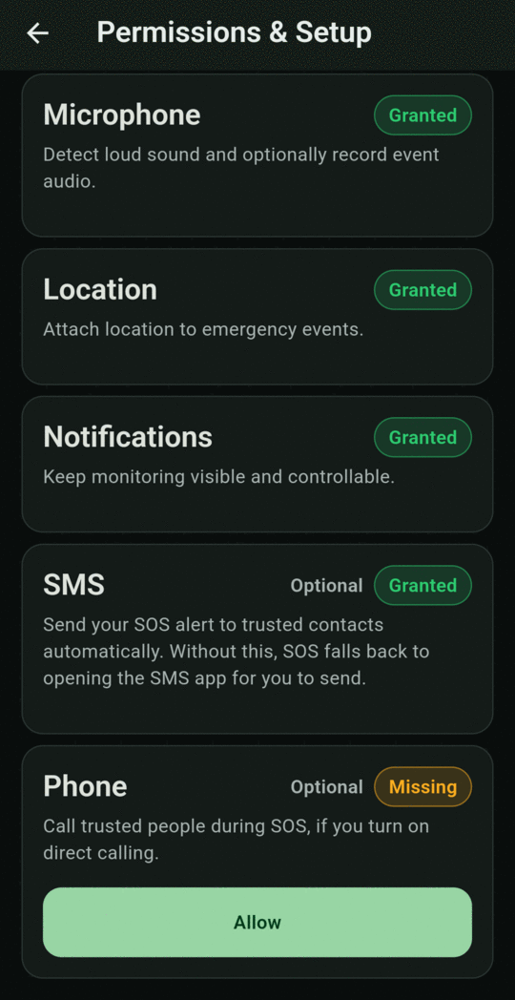

# Grant permissions

Open **Setup** from the bottom bar to see the **Permissions & Setup** screen. Each card explains why the app needs that permission and shows its status:

| Status | Meaning |
|---|---|
| **Granted** (green) | Allowed. Nothing to do. |
| **Missing** (amber) | Not allowed yet. Tap **Allow**. |
| **Blocked** (red) | You denied it earlier and Android won't ask again. Tap **Open device settings** and allow it there. |

<figure markdown>
{ .screen }
<figcaption>Required permissions</figcaption>
</figure>
<figure markdown>
{ .screen }
<figcaption>Optional permissions — Phone is still missing here</figcaption>
</figure>

## Required permissions

You can't arm monitoring until all four are granted.

Camera
:   Records and analyses the scene while armed.

Microphone
:   Detects loud sounds and, if you choose, records audio with the video.

Location
:   Attaches your location to emergency events and SOS messages.

Notifications
:   Shows the ongoing monitoring notification, which also carries the **Stop**, **Cancel Alert** and **SOS** buttons.

## Optional permissions

SMS
:   Lets SOS text your trusted contacts automatically. Without it, SOS opens your SMS app with the message ready, and you have to press send.

Phone
:   Lets SOS place a call by itself if you turn on [Call directly during SOS](../settings.md#direct-emergency-actions). Without it, SOS opens the dialer with the number filled in.

Display over other apps
:   Lets SOS open your phone's dialer for the police or another emergency number while the app isn't on screen, for example when the phone is in your bag. Android blocks this otherwise. Tapping **Allow** opens a system screen where you switch it on for BY Protect. Without it, use the **Call Police** button in the SOS notification.

!!! warning "Grant SMS for hands-free alerts"
    A [silent alert](../alerts/silent-alert.md) can only reach your contacts through automatic SMS. If SMS permission is missing, silent alerts can't send anything.

## Extra permissions for some features

Two optional features need special permissions that Android only lets you grant in system Settings. You'll find an **Open settings** shortcut for each in the app's Settings:

- **Hardware button SOS** needs an *Accessibility* permission. See [Hardware button SOS](../settings.md#hardware-button-sos).
- **Lock device on SOS** needs a *Device Admin* permission. See [Lock device on SOS](../settings.md#lock-device-on-sos).
