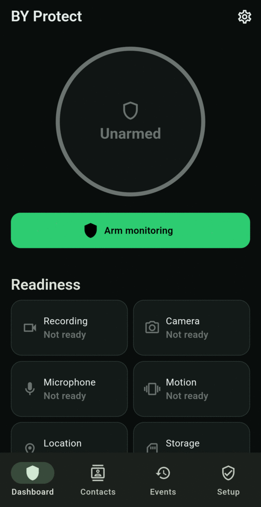
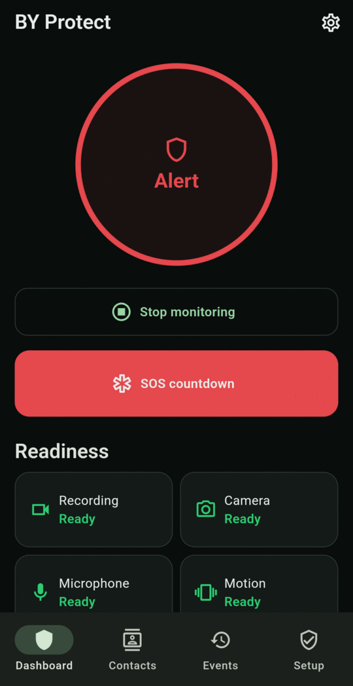

# BY Protect User Guide

BY Protect is a personal safety app for Android. Once **armed**, it watches for signs of trouble through your phone's camera, microphone and motion sensors. It keeps a short rolling video recording, and when something serious happens it alerts the people you trust with your location.

<figure markdown>
{ .screen }
<figcaption>Unarmed — ready to start</figcaption>
</figure>
<figure markdown>
{ .screen }
<figcaption>Armed — monitoring is running</figcaption>
</figure>
<figure markdown>
{ .screen }
<figcaption>Alert — SOS is active</figcaption>
</figure>

## Start here

-   :material-rocket-launch-outline: **[Getting started](getting-started/install.md)**

    Install the app, grant permissions, add your trusted contacts and arm monitoring for the first time.

-   :material-shield-check-outline: **[Everyday use](daily-use/dashboard.md)**

    Read the Dashboard, arm and stop monitoring, and choose a monitoring preset.

-   :material-alarm-light-outline: **[Alerts](alerts/levels.md)**

    Learn what the app does at each alert level, and how to cancel an alert you don't need.

-   :material-alert-octagon-outline: **[SOS](sos/triggers.md)**

    Trigger SOS from the app, the notification, the volume buttons, or by saying "help me".

-   :material-history: **[Events and evidence](events/history.md)**

    Review what happened, watch protected video and see what each cue detected.

-   :material-cog-outline: **[Settings reference](settings.md)**

    Every setting explained, with its default and when to change it.

## Key ideas in one minute

- **Nothing happens until you arm.** Monitoring, detection, recording and every SOS shortcut work only while BY Protect is armed.
- **One cue is never enough.** A single sound or bump does not raise an alarm. The app combines several cues before acting, with two exceptions: an impact followed by stillness, and clearly threatening speech. See [How alerts work](alerts/levels.md).
- **You can cancel a silent alert.** A Level 2 silent alert waits 15 seconds before it texts your contacts. Tap **Cancel** if you're safe.
- **It alerts your contacts, not the emergency services.** In immediate danger, call your local emergency number. See [Limitations and safety notes](limitations.md).
- **Re-arm after a restart.** Monitoring doesn't switch itself back on after the phone restarts.
- **Your data stays on your phone.** Events, video and location are stored only on the phone. The only things that leave it are listed in [Privacy and your data](privacy.md).

!!! tip "Search the guide"
    Press ++slash++ or ++s++, or click the search box at the top, and start typing. Search matches setting names, buttons and messages, for example *torch*, *volume*, *I'm OK* or *delete*.
