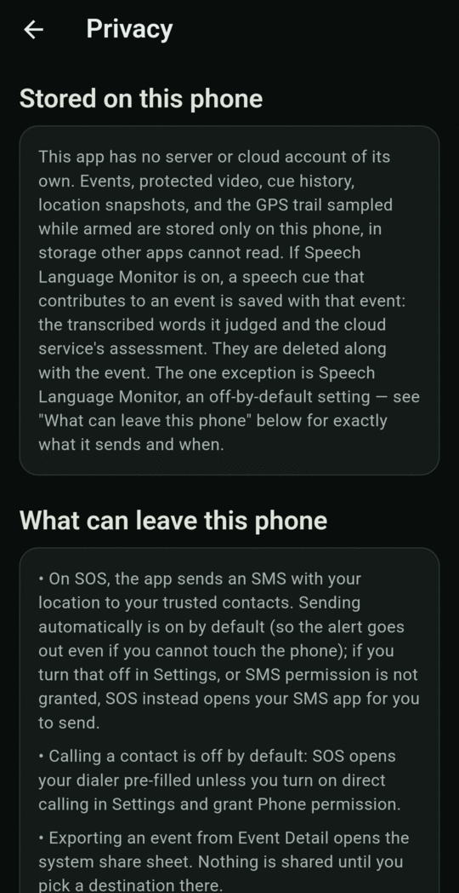
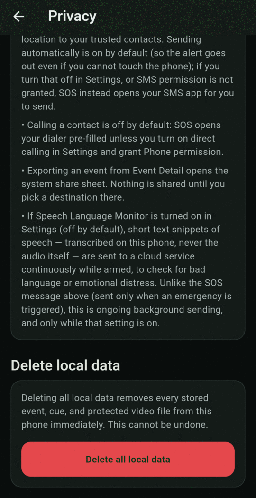

# Privacy and your data

Open it from **Settings → Privacy and local data → Privacy and delete all local data**.

<figure markdown>
{ .screen }
</figure>
<figure markdown>
{ .screen }
</figure>

## Stored on this phone

BY Protect has **no server or cloud account** of its own. These are stored only on your phone, in storage other apps can't read:

- events and their cue history,
- protected video clips (and the rolling buffer while armed),
- location snapshots, and the location history recorded while armed (see below),
- for speech cues that contributed to an event: the words that were checked and the cloud service's assessment. These are deleted together with the event.

## What can leave this phone

| When | What | Where to |
|---|---|---|
| SOS or silent alert | An SMS with your location | Your trusted contacts |
| Full SOS, if you set up calling | A phone call (no message) | Your emergency service if you added one, otherwise your first callable contact |
| You tap **share** on an event | The video clip and summary you choose to share | Wherever you send it |
| While armed, **only if Speech language monitor is on** | Short **text** snippets of speech (never audio) | A cloud service that checks for bad language, distress and threats |

Speech language monitor is **off by default**. While it's on, snippets are sent continuously while armed. SOS messages, by contrast, are only sent in an emergency.

## Location history

While armed, the app saves your location **every 60 seconds** and keeps it for **30 days**, so there's a record of where you were around an incident. It's stored only on this phone, isn't shown anywhere in the app, and is erased by **Delete all local data**. **Attach location to events** doesn't turn it off.

## Video left on the phone

Protected clips stay until you delete their event. The unprotected rolling buffer, the last few minutes before you stopped, stays until the next time you arm. **Delete all local data** removes both.

## Location on saved events

Turn off **Settings → Attach location to events** to keep GPS coordinates out of saved events. SOS messages to your contacts **still include** your location, because that's how they find you.

## Delete all local data

At the bottom of the Privacy screen, tap **Delete all local data**. You'll be asked to confirm twice (**Continue**, then **Delete everything**). Every stored event, cue, video clip (protected and rolling) and the location history are erased immediately. **This can't be undone.**

Your contacts and settings are kept.

!!! warning "No backup"
    Uninstalling the app, resetting the phone or moving to a new phone erases everything above, plus your contacts and settings. Export events you need to keep first. To remove a single event instead, see [Export and delete](events/export-delete.md).
