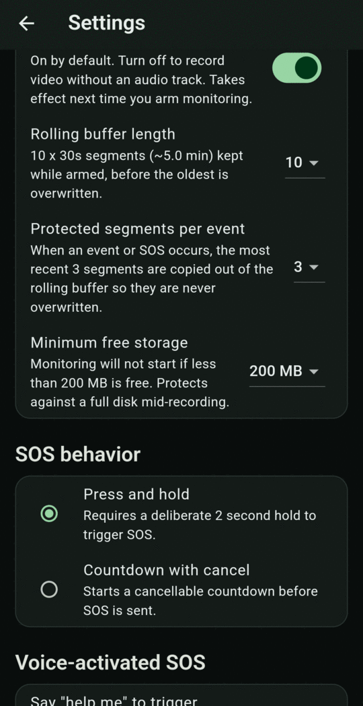
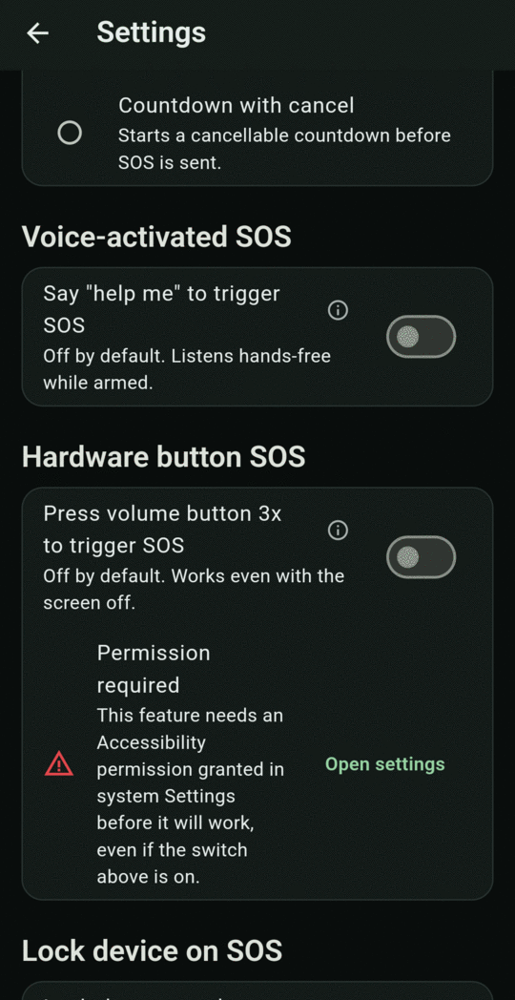
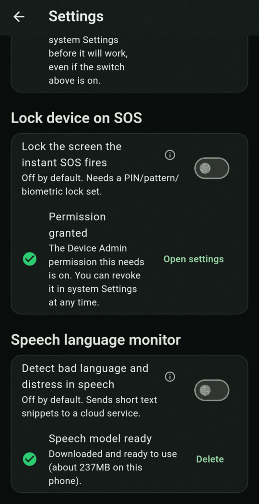
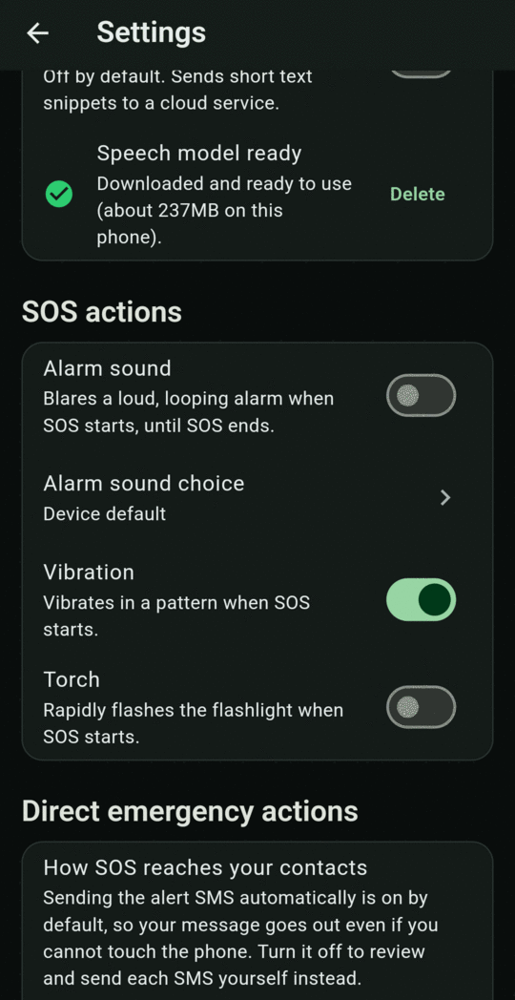
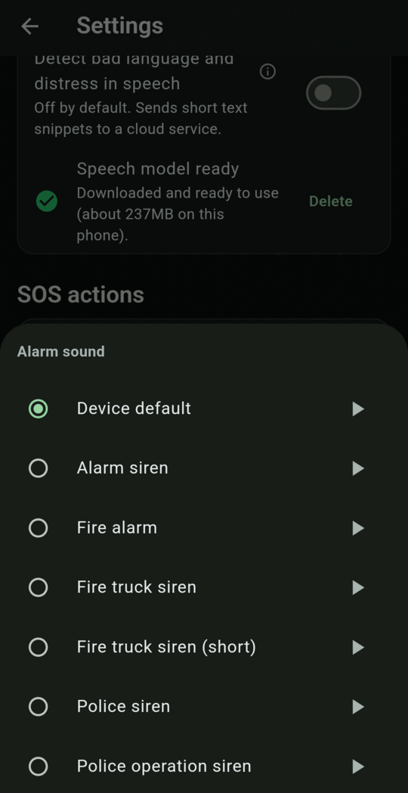
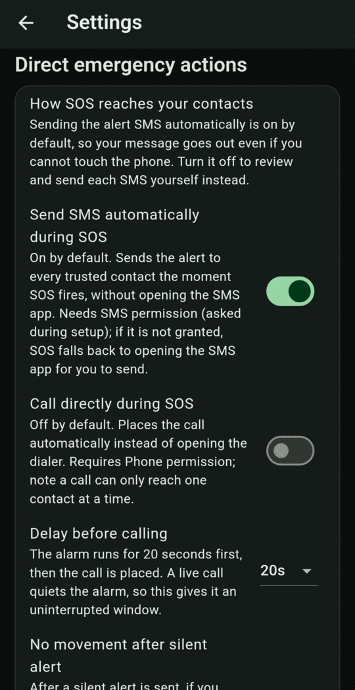
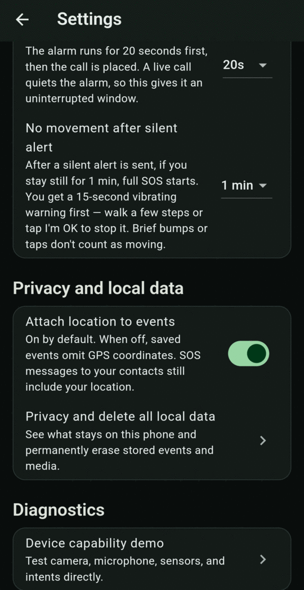
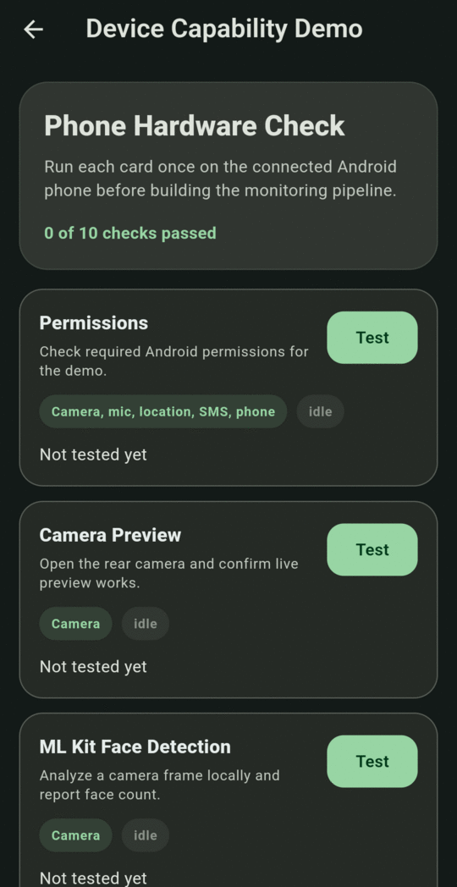
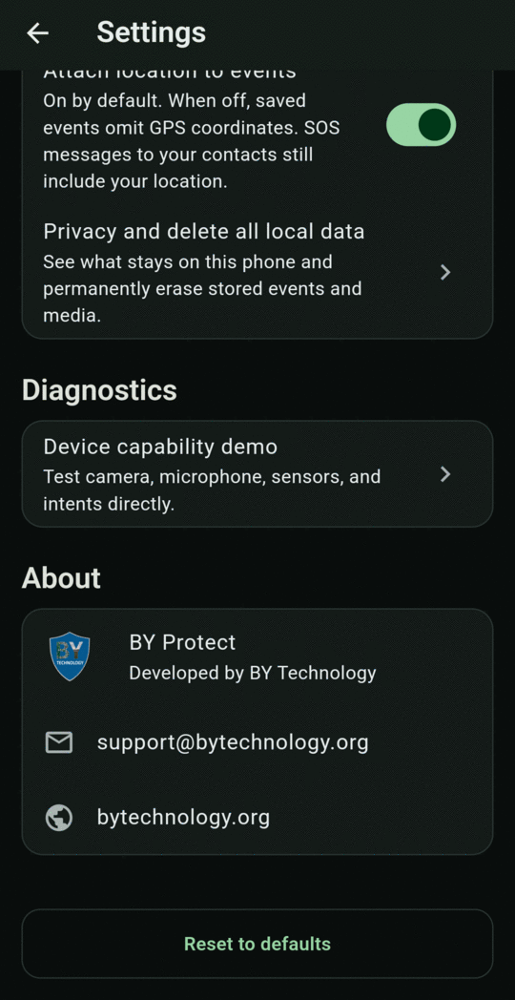

# Settings reference

Open Settings with the **gear icon** at the top right of the Dashboard. Changes save immediately. **Reset to defaults** at the bottom restores the defaults listed below.

## Monitoring defaults

{ .screen }

| Option | Default | What it does |
|---|---|---|
| **Balanced** | ✔ | Standard detection sensitivity across vision, sound and motion. Recommended for most situations. |
| **Battery saver** | | Lower sensitivity: fewer false alarms and less battery, but may miss subtle cues. |
| **Maximum coverage** | | Higher sensitivity: catches more, at the cost of more false alarms and battery use. |

See [Monitoring presets](daily-use/presets.md).

## Recording and retention

{ .screen }

| Setting | Default | Options | What it does |
|---|---|---|---|
| **Camera** | Device default (back camera) | Cameras on your phone | Which camera records. Takes effect the next time you arm. |
| **Record audio with video** | On | On / Off | Turn off to record video without sound. Takes effect the next time you arm. |
| **Rolling buffer length** | 10 | 5, 10, 20 | How many 30-second clips are kept while armed before the oldest is overwritten. 10 is about 5 minutes. |
| **Protected segments per event** | 3 | 1, 3, 5 | When an event or SOS happens, this many of the most recent clips are copied out of the rolling buffer so they're never overwritten. |
| **Minimum free storage** | 200 MB | 100, 200, 500 MB | Monitoring won't start with less free space than this, so the disk can't fill up mid-recording. |

## SOS behavior

| Option | Default | What it does |
|---|---|---|
| **Press and hold** | ✔ | The Dashboard SOS needs a deliberate 2-second hold. |
| **Countdown with cancel** | | Tapping SOS starts a 5-second countdown you can cancel. |

## Voice-activated SOS

| Setting | Default | What it does |
|---|---|---|
| **Say "help me" to trigger SOS** | Off | While armed, listens hands-free for "help me" and triggers SOS. Runs entirely on the phone. May occasionally miss the phrase, or rarely trigger on other speech. |

Tap the ⓘ next to any setting with one to read the full explanation in the app.

## Hardware button SOS

{ .screen }

| Setting | Default | What it does |
|---|---|---|
| **Press volume button 3x to trigger SOS** | Off | While armed, three quick presses of the same volume button (up or down) trigger SOS, even with the screen off. Needs the **Accessibility** permission. Tap **Open settings** and turn on BY Protect. |

The row below the switch shows **Permission granted** or **Permission required**.

## Lock device on SOS

{ .screen }

| Setting | Default | What it does |
|---|---|---|
| **Lock the screen the instant SOS fires** | Off | Locks the phone when SOS starts, so someone who takes it can't silence the alert. Needs the **Device Admin** permission (**Open settings**). Only useful if you have a PIN, pattern or biometric lock. With *Swipe* or *None* it adds no protection. |

## Speech language monitor

| Setting | Default | What it does |
|---|---|---|
| **Detect bad language and distress in speech** | Off | While armed, speech is turned into text **on the phone**, and short text snippets (never audio) are sent to a cloud service, which checks for bad language, emotional distress and threats. Results add speech cues to the alert system. They never trigger SOS by themselves. |

This feature needs a **speech model** of about **237 MB**. When you first turn it on, the app offers to download it (Wi-Fi recommended). The row below then shows:

- **Speech model not downloaded**: tap **Download**.
- **Downloading speech model…**: a progress bar.
- **Speech model ready**: tap **Delete** to free up the space.
- **Download failed**: tap **Retry**.

!!! info
    This is the only feature that sends anything from your phone in the background. See [Privacy and your data](privacy.md).

## SOS actions

{ .screen }

| Setting | Default | What it does |
|---|---|---|
| **Alarm sound** | Off | Plays a loud, looping alarm from the start of SOS until it ends. |
| **Alarm sound choice** | Device default | The sound to use. Tap ▶ to preview each one. |
| **Vibration** | On | Vibrates in a pattern when SOS starts. **Also controls** the silent-alert vibration and the no-movement warning vibration, so keep it on. |
| **Torch** | Off | Rapidly flashes the flashlight when SOS starts. |

{ .screen }

The alarm plays at full volume: arming monitoring sets the phone's alarm volume to maximum. It stays at maximum after you stop.

Built-in sounds: Alarm siren, Fire alarm, Fire truck siren, Fire truck siren (short), Police siren, Police operation siren, plus the device default.

## Direct emergency actions

{ .screen }

| Setting | Default | Options | What it does |
|---|---|---|---|
| **Send SMS automatically during SOS** | On | On / Off | Texts every trusted contact the moment SOS fires, without opening the SMS app. Needs SMS permission. If it's off or not granted, SOS opens the SMS app for you to send instead. **Silent alerts only work with this on.** |
| **Call directly during SOS** | Off | On / Off | Places the call automatically instead of opening the dialer. Needs Phone permission. SOS makes one call: your emergency service if you added one, otherwise your first callable contact. Numbers like 100 and 112 always open the dialer for you to tap Call. |
| **Delay before calling** | 20s | None, 10s, 20s, 30s, 60s, 120s | The alarm sounds for this long before the call is placed, because a live call quiets the alarm. |
| **No movement after silent alert** | 1 min | Off, 30s, 1 min, 2 min, 5 min | After a silent alert is sent, staying still this long starts a full SOS, with a 15-second vibrating warning first. See [No-movement check](alerts/no-movement.md). |

## Privacy and local data

{ .screen }

| Setting | Default | What it does |
|---|---|---|
| **Attach location to events** | On | When off, saved events don't include GPS coordinates. SOS messages to your contacts still include your location. The background location history (see [Privacy](privacy.md#location-history)) is still kept. |
| **Privacy and delete all local data** | — | Opens the [Privacy](privacy.md) screen. |

## Diagnostics

| Item | What it does |
|---|---|
| **Device capability demo** | A hardware check that tests the camera, microphone, sensors and system actions one by one. Useful if support asks you to check your phone. |

{ .screen }

## About

Shows the app name, developer (BY Technology), **support@bytechnology.org** and **bytechnology.org**. Tap either to email or visit.

{ .screen }
