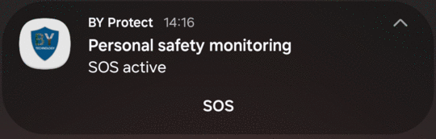

# What happens during SOS

The moment SOS starts:

1. The Dashboard ring turns red and shows **Alert**. The notification changes to **SOS active**.
2. If **Lock device on SOS** is on, the screen locks immediately, so someone who grabs the phone can't easily silence it.
3. **SOS actions** start, each only if turned on in Settings:
    - **Alarm sound**: a loud, looping alarm until SOS ends (off by default),
    - **Vibration**: a vibration pattern (on by default),
    - **Torch**: a rapidly flashing flashlight (off by default).
4. The last few video clips (default **3** clips of 30 seconds) are **protected** so they aren't overwritten.
5. Your location is captured.
6. **Your contacts are texted.** See [What your contacts receive](../alerts/messages.md).
7. After the **Delay before calling** (default **20 seconds**), the app calls your first callable contact.
8. The event is saved in Event History, with a list of the actions taken.

<figure markdown>
{ .screen }
<figcaption>Dashboard during SOS</figcaption>
</figure>
<figure markdown>
{ .screen }
<figcaption>Notification during SOS</figcaption>
</figure>

BY Protect doesn't call the emergency services. If you can, call them yourself.

While SOS is active, more SOS triggers are ignored and automatic detection pauses, so the alarm and vibration can't set off another alert.
