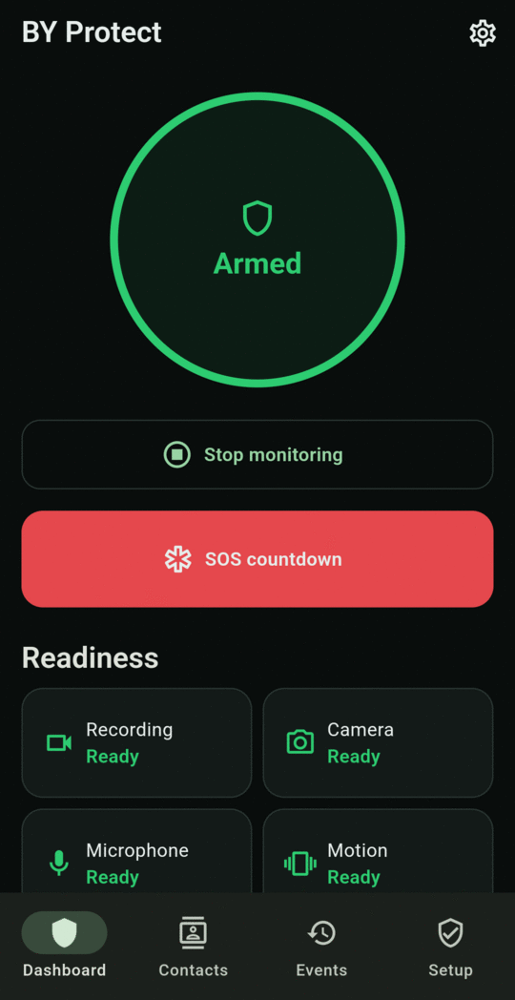
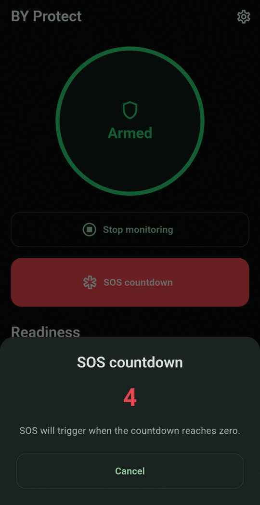
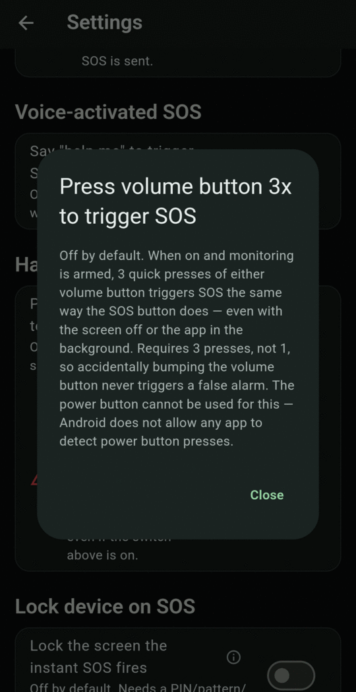

# Ways to trigger SOS

SOS is a **Level 3 · Full SOS**: it starts immediately and alerts your contacts. Every trigger below works **only while monitoring is armed**.

## 1. The SOS button on the Dashboard

What the button looks like depends on **Settings → SOS behavior**:

=== "Press and hold (default)"

    The red **Hold for SOS** bar fills as you hold it. Keep holding for **2 seconds** to trigger. Letting go early cancels.

    { .screen }

=== "Countdown with cancel"

    Tap **SOS countdown**. A 5-second countdown appears. SOS triggers at zero unless you tap **Cancel**.

    

    <figure markdown>
    { .screen }
    </figure>
    <figure markdown>
    { .screen }
    </figure>
    

## 2. The notification

Pull down the notification shade and tap **SOS** on the **Personal safety monitoring** notification. This works from the lock screen and from any app, and triggers immediately.

## 3. Volume button, three presses

Press the **same volume button 3 times within 2 seconds**. Use either up or down, but don't mix them. This works with the screen off or the app in the background.

To set it up:

1. **Settings → Hardware button SOS → Press volume button 3x to trigger SOS**: turn on.
2. Tap **Open settings** below it and turn on BY Protect's **Accessibility** permission.
3. Check the row now says **Permission granted**.

{ .screen }

The power button can't be used for this, because Android doesn't let apps detect power button presses.

## 4. Say "help me"

Turn on **Settings → Voice-activated SOS → Say "help me" to trigger SOS**. While armed, the microphone listens for the phrase, and saying **"help me"** triggers SOS. Listening happens entirely on the phone and nothing is sent anywhere.

!!! warning "Not perfect"
    Voice detection may occasionally miss the phrase, or, rarely, trigger on similar speech. Don't rely on it as your only way to call for help.

## 5. Automatically

The app can also start a full SOS by itself. See [How alerts work](../alerts/levels.md#what-raises-each-level).
